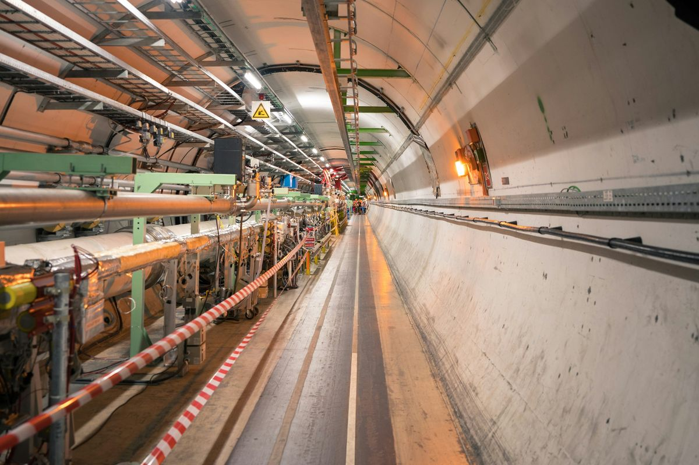
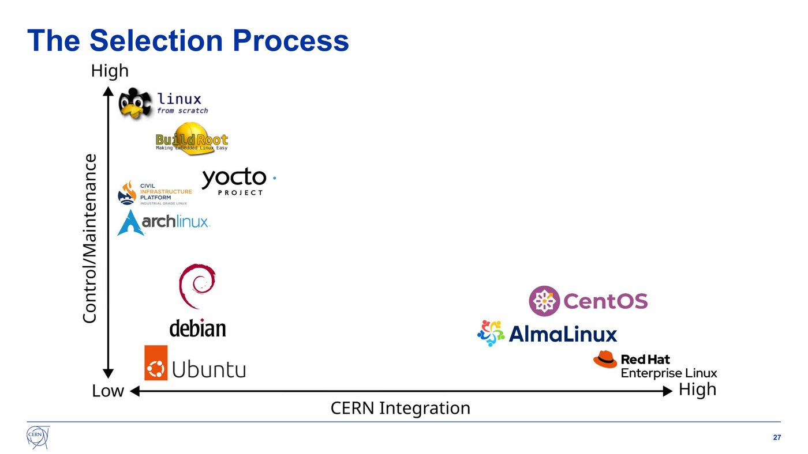

> CERN priced out staying with Red Hat before it looked anywhere else: about CHF 5.4 million (roughly EUR 5.7 million) to redesign 11 custom hardware boards, hire two electronic engineers, two software engineers and two technicians, and requalify most of the affected systems, with roughly a 20% chance of it actually working. That number, not an environmental argument, is what sent around 2,200 of CERN's accelerator control computers to Debian instead. Red Hat's reasoning for raising its hardware baseline is defensible. What's worth sitting with is what almost happened anyway: a vendor's support policy nearly forced the disposal of well over a thousand working machines, and the environmental cost of that was never on anyone's slide.

<figure class="figure mb-4 d-block">
  
  <figcaption class="figure-caption" style="font-size: 0.75rem;">Photo by Erwan Martin</figcaption>
</figure>

That's the number CERN put on staying with Red Hat, and it's the number that decided this, not a carbon figure, not a sustainability policy, not anyone in the room arguing old hardware deserves a second life. Sustainability never entered the conversation. That's exactly why the decision is worth writing about.

## What's actually moving

CERN's accelerator control system runs on three tiers of computer, and it's easy to overstate what's changing if you don't separate them. There are "consoles", the desktops and laptops physicists use, currently on AlmaLinux 10. There's a datacenter tier of high-availability servers, which moved from CentOS Linux 7 to RHEL 9 in 2022 and is guaranteed support until 2032. And there's the front-end tier, roughly 2,200 embedded computers plus around 17,000 connected devices, running real-time control software that talks directly to the accelerator's electronics.[^cern-talk]

Only that third tier is moving to Debian. Servers and consoles stay in the Red Hat family. So the accurate headline isn't "CERN drops Red Hat", it's that CERN's embedded, real-time control layer is moving to Debian while the rest of the estate stays put. The reasoning is specific to embedded hardware with long service lives, not a blanket verdict on Red Hat.

## Red Hat's side of it

Red Hat raised the minimum supported x86-64 microarchitecture level in 2022: x86-64-v2 for RHEL 9, x86-64-v3 for RHEL 10. That's not an arbitrary tightening. Red Hat's own published rationale is that very old CPUs were becoming genuinely hard to support well, partly because relevant kernel drivers were already being removed elsewhere, and that it would rather build one unified distribution than fragment support across microarchitecture levels.[^redhat-v2] The x86-64-v3 case for RHEL 10 is more concrete: modern compilers can auto-vectorise at -O2 using the wider vector registers and fused multiply-add instructions that level provides, which helps numerical workloads, and independent software vendors no longer need separate build and test paths for CPUs with and without those instructions.[^redhat-v3]

That's a legitimate engineering tradeoff, made by a vendor that is itself open source. This isn't open source rescuing CERN from a proprietary vendor's bad call. It's CERN having somewhere else to walk to, because the ecosystem it operates in doesn't lock it into one distribution.

## Why staying put wasn't the safe option either

CERN's own Q2 2023 risk analysis found the RHEL 9 baseline would exclude about 47% of its front-end fleet outright, with a further 17% excluded once the RHEL 10 baseline arrived.[^cern-talk] Combined, that's 65% of roughly 2,200 machines that would eventually need replacing just to keep running a Red Hat-family OS. A separately published 2023 paper on the same evaluation independently arrives at "about 65%" for the same population, a useful cross-check that this wasn't a one-off internal estimate.[^icalepcs]

Replacing that much of the fleet meant redesigning 11 custom hardware boards, hiring two electronic engineers, two software engineers and two technicians, re-racking and re-cabling, and requalifying most affected systems, against a hard Q4 2026 deadline. CERN put the cost at an estimated CHF 5.4 million (roughly EUR 5.7 million at current rates), with what its engineers called an "optimistic 20%, assuming bug-free solutions" chance of success.[^cern-talk] That estimate covers hardware redesign and requalification. It does not include, and CERN did not attempt to quantify, the embodied carbon or e-waste cost of decommissioning that much of a 2,200-machine fleet. We're not going to invent that number either. It wasn't part of the business case, which is itself the point.

Staying on the old baseline was never a free "do nothing" option, either. CentOS 8 is the cautionary tale: the CentOS Project announced in December 2020 that CentOS 8's support, originally planned to run to the end of 2029, would instead end on 31 December 2021, about a year after the announcement, cutting eight years of expected support with roughly twelve months' notice.[^centos8] Every option on the board, including staying still, carries a support clock. CERN just read all the clocks clearly enough to compare them.

## Why Debian, specifically

CERN evaluated candidates along two axes: how much control and maintenance burden a distribution demands, and how well it integrates with CERN's existing platform.[^cern-talk]

<figure class="figure mb-4 d-block">
  
  <figcaption class="figure-caption" style="font-size: 0.75rem;">Slide 27, "The Selection Process", from Vaga and Tsipinakis's talk, MiniDebConf Winterthur 2026</figcaption>
</figure>

Debian and Ubuntu both scored well on the first axis and poorly on the second, since CERN's tooling has long been built around the Red Hat family. High-control, low-integration options scored in the same range: Arch Linux, and embedded-Linux build tools such as the Yocto Project, BuildRoot, and the Civil Infrastructure Platform. What tipped it toward Debian was its ability to keep building for the older x86-64-v1 baseline without CERN maintaining its own toolchain, its real-time kernel patching support, and driver support for CERN's custom hardware.[^cern-talk] At the talk's Q&A, someone asked whether AlmaLinux, which supports a broader range of microarchitectures including x86-64-v1 and v2, could have been the answer instead. The CERN engineers said the AlmaLinux project simply wasn't able to commit to that level of support and validation on CERN's timeline, a timing gap, not a verdict on AlmaLinux itself.[^cern-talk]

CERN is now sponsoring Freexian, the commercial entity behind Debian's Extended Long Term Support, to keep the Debian releases it's standardising on supported out to around 2033.[^cern-talk] That lines up with what the 2023 paper describes as embedded control hardware's target lifetime, on the order of fifteen years.[^icalepcs] As Federico Vaga, one of the engineers behind the migration, put it: it's "a software solution for a software problem."[^cern-talk] [^register]

## The same shape, elsewhere

This pattern isn't unique to CERN. Windows 11 requires roughly 8th-generation Intel or Ryzen 2000-series AMD CPUs and TPM 2.0, cutting off a large population of older but functional PCs from Microsoft's supported track, and Windows 10 itself reached end of support on 14 October 2025. Separately, there's a long-running practice of installing Linux, whether Ubuntu, Fedora, or Fedora Asahi Remix, on Apple Silicon Macs that Apple's own OS updates have left behind. Different vendors, different baselines, the same mechanism: a software support policy quietly deciding how long working hardware stays useful.

## What this has to do with sustainability

CERN wasn't trying to avoid e-waste, and overstating that would undercut the actual point. What CERN had, that most organisations don't, was the engineering depth to model the alternative and the budget clarity to put a number on it. That number, CHF 5.4 million (about EUR 5.7 million) against 20% odds, made "replace 65% of the fleet" an obviously bad trade against "move the software instead." Most teams facing a rising hardware baseline don't run that analysis. They lack CERN's in-house control-systems expertise, or the standing to sponsor a distribution's long-term support arm, so they default to buying new hardware because that's the path of least resistance, not because anyone compared it against the alternative.

[ISO/IEC TS 20125-1:2026](/blog/2026-06-25-iso-20125/) has a clause that names this directly. Clause 6.2.3, in the Design phase, requires newly designed services to "ensure the oldest possible user terminals and system software are supported... to avoid forced obsolescence." CERN wasn't following that clause and had no reason to. This was an existing system facing a vendor decision, not a new service in design. But the principle is the one CERN's engineers landed on independently: treat compatibility with old, working hardware as a design constraint worth defending, not a convenience to drop the moment a vendor's baseline moves.

The real lesson isn't a checklist item. It's that this kind of decision rewards organisations that can reason about the tradeoff, model the alternative, and put a number on staying versus moving, rather than organisations that just follow whatever a vendor's default path implies. That's harder to build than a policy, and it's exactly the organisational capability GSP's interview-based assessment is designed to test for, not by checking whether you avoided one specific baseline, but by checking whether you can reason like this when the next one shows up.

If a vendor's roadmap is quietly setting your hardware refresh cycle for you, that's worth an outside look. [Get in touch](/contact/), or read about how [GSP™](https://gsp.greenseal.dev/) assesses the organisational practices behind decisions like this one.

[^cern-talk]: Vaga F., Tsipinakis N. *Controlling CERN's Accelerators with Debian*. MiniDebConf Winterthur, 30 August 2026. [Talk page](https://ch2026.mini.debconf.org/talks/6-controlling-cerns-accelerators-with-debian/), slides and video via [meetings-archive.debian.net](https://meetings-archive.debian.net/) and [salsa.debian.org](https://salsa.debian.org/).
[^icalepcs]: Radeva P., Locci L., Elyn P., Oulevey T., Vanden Eynden M. *Selecting a Linux Operating System for CERN Accelerator Controls*. ICALEPCS 2023. [https://proceedings.jacow.org/icalepcs2023/papers/thpdp064.pdf](https://proceedings.jacow.org/icalepcs2023/papers/thpdp064.pdf)
[^redhat-v2]: Weimer F. *Building Red Hat Enterprise Linux 9 for the x86-64-v2 microarchitecture level*. Red Hat Developer, January 2021. [https://developers.redhat.com/blog/2021/01/05/building-red-hat-enterprise-linux-9-for-the-x86-64-v2-microarchitecture-level](https://developers.redhat.com/blog/2021/01/05/building-red-hat-enterprise-linux-9-for-the-x86-64-v2-microarchitecture-level)
[^redhat-v3]: Weimer F. *Exploring x86-64-v3 in Red Hat Enterprise Linux 10*. Red Hat Developer, January 2024. [https://developers.redhat.com/articles/2024/01/02/exploring-x86-64-v3-red-hat-enterprise-linux-10](https://developers.redhat.com/articles/2024/01/02/exploring-x86-64-v3-red-hat-enterprise-linux-10)
[^register]: *CERN moves thousands of accelerator control computers to Debian*. The Register, 3 September 2026. [https://www.theregister.com/os-platforms/2026/09/03/cern-moves-thousands-of-accelerator-control-computers-to-debian/5294312](https://www.theregister.com/os-platforms/2026/09/03/cern-moves-thousands-of-accelerator-control-computers-to-debian/5294312)
[^centos8]: *The Future is CentOS Stream*. The CentOS Project, 8 December 2020. [https://blog.centos.org/2020/12/future-is-centos-stream/](https://blog.centos.org/2020/12/future-is-centos-stream/)
