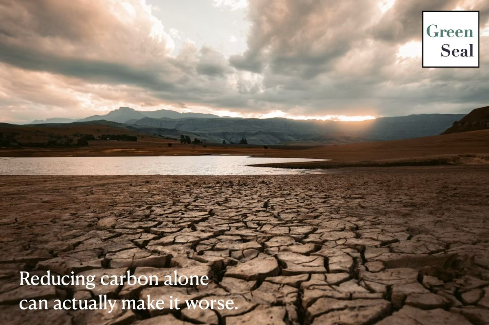

> Switching electricity generation from coal to bioenergy cuts the carbon footprint of that electricity by about 72% on average. It also multiplies the water footprint more than 30 times and the land footprint by roughly a hundredfold. That is what happens when a decision gets optimised for one metric while two others move the opposite way, and it is exactly the blind spot now showing up in AI's own energy growth. A 2026 UNU-INWEH report supplies the numbers. The argument is ours: carbon-only reporting cannot see the tradeoff it is making, and the people who did not choose to carry it are the ones who inherit it.

<figure class="figure mb-4 d-block">
  
  <figcaption class="figure-caption" style="font-size: 0.75rem;">Photo by RedCharlie</figcaption>
</figure>

Optimise a decision for carbon alone and you can end up making it worse. That is not a hedge, it is arithmetic. Switch electricity generation from coal to bioenergy and the carbon footprint of that electricity falls by about 72% on average. The water footprint of the same switch rises more than 30 times. The land footprint rises roughly a hundredfold. That comparison is about electricity generation in general, not about AI hardware or AI workloads specifically, and it is worth holding onto that distinction because the rest of this post is about what happens when the same blind spot shows up at AI's own scale. If your sustainability reporting only tracks carbon, the coal to bioenergy swap reads as an unambiguous win. It isn't.

That figure, and most of what follows, comes from a 2026 report by researchers at the United Nations University Institute for Water, Environment and Health, *Environmental Cost of AI's Energy Use: Carbon, Water and Land Footprints*.[^unu] We are citing it for its numbers, not writing this post about it. The point it is evidence for is simple, and easy to forget in practice: carbon, water, and land do not move together. Improving one can quietly worsen another, and a decision that looks obviously right when carbon is the only thing you are watching can look considerably worse once you check the other two.

## Why one metric hides two others

Carbon got the reporting infrastructure first. It has a global accounting standard, a market price in some jurisdictions, and a single unit that adds up cleanly across a supply chain. Water and land don't travel that well. A litre of water used in a drought-stressed region and a litre used somewhere with abundant rainfall are not the same cost, and a square kilometre of land has a different meaning depending on what it displaces. That's not a reason to ignore them, it's the reason they get ignored. Metrics that are hard to standardise get left off the dashboard, and what's left off the dashboard stops counting as a cost at all. The coal to bioenergy swap is the cleanest illustration of what that produces: a genuinely worse decision wearing the outfit of a genuinely better one, because only one of its three effects was being measured.

## This is already happening at AI's scale

The same blind spot shows up in the numbers behind AI's own growth. UNU-INWEH estimates data centres consumed about 448 TWh of electricity in 2025.[^unu] For 2030, we can go to the source UNU-INWEH itself relies on: the IEA's *Energy and AI* report, whose Base Case has data centre electricity more than doubling from 415 TWh in 2024 to around 945 TWh by 2030, close to 3% of projected global electricity use.[^iea]

That 945 TWh is total data centre electricity, not AI's share of it. AI workloads accounted for around 20% of data centre electricity in 2025, projected to reach about 40% by 2030.[^unu] The growth curve is increasingly AI-driven, which is why this is worth calling an AI energy story at all, but the accurate sentence is "data centre electricity, an increasingly AI-driven number, projected to roughly double by 2030," not "AI will use 945 TWh."

UNU-INWEH ties that 2030 electricity projection to a water footprint of 9.3 trillion litres, framed against the basic annual domestic water needs of the 1.3 billion people living in Sub-Saharan Africa, modelled at 20 litres per person per day.[^unu] The same projection carries a land footprint exceeding 14,500 square kilometres, about ten times the size of Mexico City or twice the Jakarta metropolitan area.[^unu] Those numbers are hard to hold in your head, which is exactly why a single carbon figure is so much easier to report, and why reporting it alone gives an incomplete account of what a decision costs. The advantages of that growth tend to flow to whoever is deploying the models. The water and land burden of the infrastructure underneath it lands on the communities and ecosystems where that infrastructure is sited, which are not always the same places, and did not get a vote either way.

## Efficiency was never going to be enough

None of this is an argument against AI, or against bioenergy. As the report puts it, "acknowledging the challenges is not a rejection of progress."[^unu] But it does mean the industry's default answer, efficiency, cannot carry the whole load on its own. The report names the mechanism directly: the rebound effect, or Jevons Paradox, after William Stanley Jevons's nineteenth-century observation that more efficient coal use in England did not reduce coal consumption, it expanded what coal got used for. Per-query efficiency gains in AI are real and worth pursuing. Falling cost per unit of compute also tends to drive wider deployment and rising aggregate use, and the report's conclusion is blunt about what follows from that: efficiency gains alone are unlikely to deliver absolute reductions in energy use without complementary demand-side measures or governance alongside them.[^unu]

## What we think this means for how you measure

[ISO/IEC TS 20125-1:2026](/blog/2026-06-25-iso-20125/), the technical specification for digital services ecodesign, actually tracks land use. Its Annex C covers roughly sixteen environmental impact categories, land use among them. But the standard's own editorial note flags only four as usually material for digital services: climate change, water use, resource use for minerals and metals, and resource use for fossil fuels. Land use is tracked, not flagged, which means an organisation can fully meet the standard's own materiality guidance without separately assessing exactly the footprint this report is asking people to stop overlooking.

That gap is a reasoning problem, not a checklist problem. A practice, a substitution, or a metric that looks correct in isolation can be wrong once you check what else it touches, and no fixed list of approved practices catches that on its own, because the next tradeoff won't look like the last one. That's why GSP's assessment is built around interviews and document review that test whether an organisation actually practises this kind of reasoning about tradeoffs, rather than matching a checklist item by item.

## What to actually do about it

Three things follow directly. When you're choosing a cloud region or a hosting provider, ask about the water and land intensity of the local generation mix, not just its carbon intensity or the facility's PUE. If you're going to claim a sustainability position at all, disclose more than carbon, water usage effectiveness and siting context included, because a carbon-only claim is now a visibly incomplete one. And treat efficiency work as necessary but not sufficient. Pair it with actual demand reduction, because the rebound effect means efficiency gains on their own tend to get absorbed by scale rather than banked as savings.

If you want to work out what an honest account of your own stack looks like, beyond the carbon number that's easiest to produce, [get in touch](/contact/). And if you want independent, interview-based verification of the organisational practices behind a sustainability claim, rather than a self-reported one, that's what [GSP™](/gsp/) is for.

[^unu]: Aczel M., Chamanara S., Matin M., Farsi A., Marwala T., Madani K. *Environmental Cost of AI's Energy Use: Carbon, Water and Land Footprints*. UNU-INWEH, 2026. [Report](https://unu.edu/inweh/collection/environmental-cost-of-AIs-Enrgy-Use-Carbon-water-and-land-footprints), [press release](https://unu.edu/inweh/news/environmental-cost-of-AIs-Enrgy-use-carbon-water-and-land-footprints).
[^iea]: IEA. *Energy and AI*, Executive Summary. 2025. [https://www.iea.org/reports/energy-and-ai/executive-summary](https://www.iea.org/reports/energy-and-ai/executive-summary)
