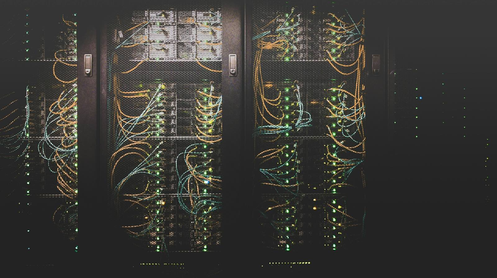

> "Today, there are energy efficiency standards for equipment, but not AI models."[^iea-p9] That sentence sits in the executive summary of the International Energy Agency's new report for the G7. The report splits data centre efficiency into three layers, facility, IT equipment and software, and finds that policy mostly works on the first. Our reading goes further than the IEA does: software, AI systems included, decides how much computing gets done in the first place, and it is the layer that gets the least attention. Here is what the report says, where we think it points, and what to do while regulation catches up.

<figure class="figure mb-4 d-block">
  
  <figcaption class="figure-caption" style="font-size: 0.75rem;">Photo by Taylor Vick</figcaption>
</figure>

Every efficiency rule for data centres starts from the same assumption: the work is a given, and the job is to deliver it with less waste. Cool the building better. Lose less power in conversion. Buy servers that do more per watt. The rules rarely ask whether the work was actually necessary. The wider debate looks in the same direction: grid connections, cooling, water, power contracts. All of it is about the building. Very little of it is about the code inside.

The IEA's recent report makes the gap hard to miss. *Powering Artificial Intelligence: Strategies for integrating data centres into electricity systems* was requested by France, which holds the G7 Presidency, and published on 14 October 2026. It covers 34 jurisdictions with about 90% of the world's data centre capacity.[^iea-p3] Most of it concerns grids, tariffs and who pays, which says a lot about where the attention is. The efficiency chapter is the one software engineers should read.

The stakes, in the IEA's numbers: the electricity data centres consume is tied to roughly 150 million tonnes of CO2 today. The agency's central scenario has that rising to around 350 million tonnes by 2035, about 1.5% of global energy-related emissions.[^iea-p9]

## Three layers, and policy lives in one

The IEA treats data centre efficiency as three connected layers.[^iea-p25] The facility layer is the building, cooling and power delivery. The IT layer is the servers, storage and networking, and how fully they are used. The software layer, in the report's framing, sets how much computing a task needs at all. When the report maps policy tools to each layer, software gets measurement, disclosure and energy-per-task indicators, nothing more.[^iea-p28]

Existing policy concentrates on the facility.[^iea-p28] Reporting is the most common intervention across the jurisdictions reviewed, and the IEA's explanation is telling. A site's energy, water and heat can all be tracked "without defining the value or performance of the computing delivered".[^iea-p28] In other words, regulators simply measure what is easy to measure: the building.

Conventional servers at least have established performance-per-watt benchmarks behind voluntary labels and EU ecodesign rules.[^iea-p26] For software, the report observes that current policy generally gives no reward for fitting a model's capabilities and compute to the job at hand.[^iea-p27]

## PUE measures the building, not the work

Power usage effectiveness (PUE) and water usage effectiveness (WUE) are the headline numbers of data centre sustainability. The IEA calls them "important but incomplete".[^iea-p31] Neither reveals how much useful computing software and models deliver, and a low value does not guarantee low absolute electricity or water use.[^iea-p31] PUE also moves with IT load, so an improved PUE at higher load is not, by itself, evidence of more useful work per unit of electricity.[^iea-p30] Utilisation does not settle the question either. A busy server is not necessarily a productive one.[^iea-p26]

We have written before about what PUE and WUE miss on the [water and land side](/blog/2026-09-28-carbon-water-land-tradeoffs/). This gap is different. Even a perfect facility metric is silent on whether the workload inside was worth running.

## The incentives point the wrong way, mostly

The IEA is candid about market pressure. Compute is expensive, so AI labs have reason to make models more efficient. They are also under pressure, and well funded, to grow their user base and usage. The report warns this may lead to "offering the best-performing models even if smaller, more efficient ones could satisfactorily complete many tasks".[^iea-p10]

The report also sees a counterweight. Sending simpler requests to smaller models lowers compute bills, so commercial incentives may help on their own.[^iea-p27] It points to research estimating that the compute needed to reach a given level of language model performance has halved about every eight months.[^iea-p27] Leading AI processors and accelerators gained roughly 30 to 40% a year in performance per watt between 2016 and 2025, on average, though the IEA cautions this is not a like-for-like saving on a fixed workload.[^iea-p25]

Total AI electricity demand is still expected to climb.[^iea-p25] On the wider point the report is unambiguous: with demand for computing growing this fast, "efficiency alone is unlikely to reduce aggregate data centre electricity demand in the near term".[^iea-p33] Its near-term value, in the IEA's view, is slowing growth and deferring new generation and grid build-out.[^iea-p33] The IEA puts this down to fast-growing demand. Whether efficiency itself feeds that growth, the rebound effect, is something we [covered previously](/blog/2026-09-28-carbon-water-land-tradeoffs/), so we won't repeat it here.

## Our reading: we optimise the stack so software can stay wasteful

This section is GreenSeal's argument, not the IEA's. The report frames the software layer around the choice of AI model. But a model is one component of an AI system. Prompts, context size, retrieval pipelines, agent loops, caching and the application around the model all decide how much computing a task ends up using, and AI is now built into more and more of the software we ship. So we read the gap as covering the whole software layer, AI systems included, not just which model gets picked.

Software is where demand originates. Every watt a facility saves, and every gain in performance per watt, ends up serving whatever the software asks for. The IEA notes that a gain in one layer can carry into others, with more efficient servers also needing less cooling.[^iea-p26] Follow that logic up the stack and the cascade is longest from the top. A computation that never runs needs no server time, no cooling, no power conversion and no grid connection, provided the capacity it would have needed is never built or is scaled down. That makes software, in our view, the main driver of resource demand and the layer with the most leverage.

It is also the layer with the least attention and the least pressure on it. Facilities face reporting duties and, less commonly, binding PUE requirements, as in Germany.[^iea-p29] Hardware faces product standards.[^iea-p28] Software faces little beyond early disclosure duties for general-purpose AI[^iea-p27] and voluntary schemes. So the industry does the rational thing under those incentives. It makes the infrastructure ever more efficient, then spends the headroom on bigger and more tangled systems on top. A model several sizes too large for the job. An agent that calls a frontier model ten times for an answer a lookup could give. A dozen services where three would do. A dependency pulled in for one function. Features nobody uses, kept alive because removing them is nobody's job. Efficiency at the bottom ends up subsidising waste at the top.

The qualities that keep software demand in check are efficiency, reuse, simplicity and maintainability, and efficiency policy rewards none of them. Maintainability matters more than it seems. A system nobody understands is a system nobody dares to slim down.

## Regulate or certify? Both, voluntary first

Should regulation fix this? Eventually. The IEA is clear about why it is not ready. Setting standards at the model level is very difficult because the technology improves extremely fast, AI services vary widely and baselines are uncertain.[^iea-p10] Energy-per-task figures are only meaningful when comparing similar tasks at similar performance levels, since energy needs differ greatly across text, image, video, reasoning and agentic uses.[^iea-p27] Disclosure of utilisation and task-level metrics still needs standardising.[^iea-p33]

Regulation is starting anyway. Under the EU AI Act, general-purpose AI providers must document the energy their models are known or estimated to use, and the European Commission is working on standardised methods for training and inference.[^iea-p27] (We looked at [what the AI Act does and does not require previously](/blog/2026-02-06-ai-act/).) For facilities, the IEA describes a route the EU is already on: reporting first, then comparable benchmarks, then requirements once indicators are mature enough.[^iea-p28]

That route takes years, and software metrics are at its very start. Whether your engineering practices are built to keep computing demand in check is a question that can be assessed today.

This is the gap voluntary certification fills. We believe the way forward is to assess practices and team capability rather than a single number, and that is the core of [GSP™](https://gsp.greenseal.dev/). It does not prescribe a model size. It asks whether teams explicitly consider resource efficiency in software and AI architecture and design (ARC-01), and whether they weigh efficiency against other qualities such as accuracy, user experience and maintainability (ARC-02). It looks for optimisation of data pipelines and AI/ML models (ARC-03), for identifying and cutting unnecessary computation, data transfer and storage (ARC-04), for periodic efficiency reviews of dependencies (ARC-05), and for checking during requirements whether a feature justifies its resource cost (ARC-06). And it expects the measurement that makes this demonstrable: resource usage measurement, energy or carbon monitoring, and attribution to specific components (MEA-01, MEA-02, MEA-04). Teams can start with a lighter Level 1 self-assessment. The full set of requirements above belongs to Level 2, which is verified independently through interviews and document review.

None of that replaces regulation. It builds the practice, and the evidence, that regulation will eventually need.

## What to do now

1. **Ask how much computing a task needs before asking how efficiently it is delivered.** Make it a standing question in design reviews and architecture decision records, for features as much as for models.
2. **Measure your workload, not your provider's building.** A cloud region's PUE tells you nothing about how much computing your services ask for. Attribute resource use, and energy where you can, to services and features so you know which ones drive demand. Measuring software energy [is hard](/blog/2026-01-20-problem-of-measuring/), and still worth doing.
3. **Default to the smallest thing that does the job.** The smaller model, the simpler architecture, the dependency you didn't add, the feature you didn't build. Make the bigger option the one that needs justifying.

The IEA has told the G7 where the measurement stops. Our view is that it stops just below the layer that matters most. It is time some of the attention on the data centre went to the code that runs in it. If you want help putting numbers and practices on your own software layer, [get in touch](/contact/). If you want independent verification that those practices are real, that is what [GSP™](https://gsp.greenseal.dev/) is for.

### A note on AI use

We used AI (Claude, through Claude Code) to help analyse the IEA report, check citations and refine drafts. The analysis and the conclusions are the author's, and so is the responsibility for any errors. We estimate the AI work used between 0.27 and 0.83 kWh of electricity, most likely around 0.43 kWh, corresponding to between 16 and 600 g CO2e, most likely around 170 g. The range is wide because the carbon intensity of the electricity behind the model is unknown. The estimate is based on token counts with our open-source tool [pegada](https://github.com/GreenSeal-dev/pegada-code).

[^iea-p3]: IEA (2026), *Powering Artificial Intelligence: Strategies for integrating data centres into electricity systems*, pp. 3 and 6. [https://www.iea.org/reports/powering-artificial-intelligence](https://www.iea.org/reports/powering-artificial-intelligence). Licensed CC BY 4.0.
[^iea-p9]: IEA (2026), *Powering Artificial Intelligence*, p. 9.
[^iea-p10]: IEA (2026), *Powering Artificial Intelligence*, p. 10.
[^iea-p25]: IEA (2026), *Powering Artificial Intelligence*, p. 25.
[^iea-p26]: IEA (2026), *Powering Artificial Intelligence*, p. 26.
[^iea-p27]: IEA (2026), *Powering Artificial Intelligence*, p. 27.
[^iea-p28]: IEA (2026), *Powering Artificial Intelligence*, p. 28.
[^iea-p29]: IEA (2026), *Powering Artificial Intelligence*, pp. 28 to 29.
[^iea-p30]: IEA (2026), *Powering Artificial Intelligence*, p. 30.
[^iea-p31]: IEA (2026), *Powering Artificial Intelligence*, p. 31.
[^iea-p33]: IEA (2026), *Powering Artificial Intelligence*, pp. 33 to 34.
